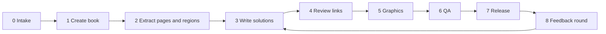

# Workflow: from two PDFs to a live book

This is the standard pipeline for adding a chapter to the databank. It is the JM26 (B) build, reordered and simplified: everything that took a feedback round on JM26 (B) is now a default from the start (see "Defaults learned from JM26 (B)" at the end).



| Stage | Output | Tool | Typical effort |
| --- | --- | --- | --- |
| 0 Intake | chapter brief | — | 5 min |
| 1 Create | `books/<id>/` with the PDFs | `new_book.py` | 1 min |
| 2 Extract | `book.json` question list, `pages/`, `layout.json`, teacher crops | `extract_pages.py`, `extract_ans_refs.py` | 30 min |
| 3 Solutions | `solutions.js` | ANS crops | the largest step |
| 4 Links | `links` in `solutions.js` | `check_book.mjs` | medium |
| 5 Graphics | `widgets.js` | `engine/widgets/kit.js` | large |
| 6 QA | report and screenshots | `check_book.mjs --shots` | 30 min |
| 7 Release | live link | git, GitHub Pages | 5 min |

---

## Stage 0: Intake

**Book four legs on day one, for every new chapter.** Work is not just "who builds what": each
chapter needs a build leg, a content leg, a numbers leg and a picture leg, and the last three are
people who did not write the thing they check. spem05 ran its whole production line — intake,
solutions, layout, widgets, films, verification — with the content and numbers legs missing, and
its q4 widget taught a wrong model until a measurement caught it.

| leg | who | what it does | signs off at |
|---|---|---|---|
| build | `ebook`, `visual`, `Cine`, `layout-engineer` | solutions, widgets, films, regions and space | — |
| content (physics) | `physics-lead` (the subject lead) | the ANS reading, every solution's physics, every printed figure a widget draws on, and any simplification that would teach something wrong. Read-only, ending in a per-question verdict (correct, or problem + evidence + fix). | [Stage 7](#stage-7-release) |
| content (maths) | `maths-lead` (the subject lead) | the same job for P1–P6, S1–S6 and M1/M2: the ANS reading, every solution's method and `hence` chain, every printed figure's geometry marks, units and significant figures, the maths behind every widget, and any simplification that would mislead — e.g. a general case drawn as a special one. Read-only, per-question verdict. Uses `maths-content-review`. | [Stage 7](#stage-7-release) |
| numbers | `verifier` | recomputes every answer from the printed data **first**, then matches `solutions.js` and the teacher's key; three-way disagreements written out, never smoothed. Read-only. | [Stage 7](#stage-7-release) |
| picture | `3Dwork`, or whoever did not build it | the same harness on the real reader: `.ctl` rect and right edge, ink under the strip, the 4 pt ring, every control actually changing something, page errors | [Stage 6](#stage-6-qa) |

None of them stands in for another. A layout gate proves the page renders; a measurement proves the
drawing matches the page; neither says whether the physics or the number is right.

**Name the subject lead before intake finishes**: `physics-lead` for physics, `maths-lead` for maths
(P1–P6, S1–S6, M1/M2). A book with no content leg assigned does not move to Stage 2.

What is needed from the teacher for each chapter:

- [ ] The **QUE PDF**: the question notes with blank answer spaces. Its pages become the ebook's background.
- [ ] The **ANS PDF**: the same notes with the teacher's working in red-bordered boxes. This defines the method every solution must follow.
- [ ] The **form, code and title**, taken from the official topic registry in `docs/topics/`
  (`maths.json`, `physics.json`, generated by `tools/import_topics.py` from the Uni+ topic lists).
  The registry is the source of truth: the book's `code` and `title` must match a row there, and the
  English name is copied character for character — e.g. S3 · JM26 (B) · Inequalities I.
  A split volume keeps its part letter in `code` only (`JM29 (C)`); `topicCode` stays `JM29` and the
  registry's name (`Quadrilaterals`) is the same for every part. A code the list does not have is a
  data-entry mistake, not a new topic.
- [ ] Any **special requests**, for example a particular graphic ("Q2: fix the side at 3, slider for the number of sides").

Decide and note in the chapter log (`docs/chapters/<id>.md`):

- the **book id**: short, lower case, never renamed later, e.g. `jm26b`. It names the saved-ink store on every iPad;
- the **sections** for the top bar, from the section titles in the notes (e.g. Practical, MC, Challenge);
- which questions are **printed worked examples**. Their answer is already on the page, so they get only a graphic button.

## Stage 1: Create the book

```powershell
python tools/new_book.py <id> --form S3 --code "JM27 (A)" --title "Inequalities II" --topic Inequalities --que "<path>\...(QUE).pdf" --ans "<path>\...(ANS).pdf"
```

This copies `books/_template/`, puts both PDFs in `books/<id>/source/`, fills in `book.json`, and adds the book to `books/catalog.json` with status `draft`. Also copy `docs/chapters/_template.md` to `docs/chapters/<id>.md`.

Check the pair against the registry before and after creating the book — it takes a second and it is
the only thing that keeps codes from drifting:

```powershell
python tools/check_topic.py --code "JPWM01" --title "Nature of waves"   # before: does the pair exist?
python tools/check_topic.py jpwm01                                     # after: does the book match?
```

`ok` means the code exists and the title is identical to the list. `NAME DIFFERS` means the title was
typed by hand instead of copied; `CODE NOT IN LIST` means the code was invented (or carries a
free-text form like `PHY CH6`). `docs/topics/consistency.md` lists the verdict for every book.

**Only the ANS was supplied?** Make the question paper from it first, and pass that as `--que`:

```powershell
python tools/make_que.py "<path>\...(ANS).pdf" "<path>\...(QUE made).pdf" [--red-text list|cover|black]
```

It removes the teacher's pure-red answer boxes (text, line art, and images mostly inside a box), the "Answer" stamp, and the `*` that marks an MC answer. Figures that only overlap a box are kept whole; a teacher image laid over a figure is deleted as an object, so the figure underneath shows again. A thin white line over each removed frame hides faint leftover edges, except where the frame crossed a figure, so it never cuts through one. Red text outside the boxes is listed by default; use `cover` for stray working or `black` when the correct MC option is printed in red. Then compare it with the ANS page by page: every figure must be there and no red working left. When a chapter does have a real QUE, `make_que` on its ANS should match it exactly (JM29 (B): 0 pixels different), which is a good check after changing the tool.

## Stage 2: Extract pages and answer regions

1. **Draft the question list:**
   ```powershell
   python tools/extract_pages.py <id> --scan
   ```
   This prints the section titles it finds, and a JSON draft of every numbered question and Example/Practice heading with its page. Copy it into `book.json` → `extract.questions`, then:
   - give each item a `section` id from `book.json` → `sections`;
   - use the standard ids: `ex1`, `ex2` for examples, `p1a`, `p1b`, `p2` for practices, `q1` … `qN` for numbered questions. `label` is what the jump list shows: "Example 1", "Practice 1a", or just "12" for numbered questions;
   - move each heading's `anchor` regex into `extract.anchors` (`{"ex1": "Example\\s*1"}`). Numbered questions need no anchor: the tool finds "12." at the left margin;
   - delete false hits, such as a section title or a number inside a table.
2. **Render the pages and find regions:**
   ```powershell
   python tools/extract_pages.py <id>
   ```
   This writes `pages/p01.jpg` … (3× zoom, JPEG quality 86) and `layout.json`. Each question's answer region runs from the bottom of its printed text to the next question, or to the footer.
   - `MISSING ANCHOR qX page N` means the label was not found. Fix `anchors`, or pin it with `fixedAnchors` (`"ex2lq": [y0, y1]` in PDF points).
3. **Override regions the gap rule cannot infer** (`extract.overrides`, in PDF points `[x0, y0, x1, y1]` with the origin at the top left; a page is 595 × 842):
   - framed or boxed examples and practices: `region`;
   - MC questions, where the working space sits beside the options: `region`, plus `square` for the printed answer box;
   - an option to circle: `ring`.

   Find coordinates by opening the page image (1 pt = 3 px at zoom 3), or from the words in `layout.json` → `pages[n].text`. Re-run step 2 after every change.
4. **Crop the teacher's working:**
   ```powershell
   python tools/extract_ans_refs.py <id>
   ```
   This writes `reference/ans/pNN_KK.png` and full-page previews in `reference/ans_pages/`. Two kinds
   of crop, in this order on each page:
   - **red boxes** (a red drawing at least 40 × 30 pt) — how the teacher frames most answers;
   - **red-text clusters** — red text spans and small red line art (a hand-drawn arrow, a tick) that
     sit outside every box already cropped, joined into one crop per answer block (marks closer than
     8 pt are merged, so a two-line answer comes out whole).

   The second pass exists because some pages answer in red **text with no box at all** (spem05 p1:
   "Upwards", "No force", "Out of paper", "Into paper"; p11: the motor answer and its red arrows).
   Before it those pages produced no crop and the answer had to be read off the 2× preview. A page
   that is fully boxed produces exactly the crops it produced before, so old books do not change.

   Two traps in that tool, both found on spem05 in 2026-11-25:
   - **`Rect |= other` is not in place.** PyMuPDF rebuilds the rect, so a cluster that "absorbed" a
     second line silently dropped it and the crop showed only line 1 of a two-line answer. Write the
     union back (`out[j] = box | r`) or use `include_rect`.
   - the red-text colour test is on the span's sRGB integer (`0xRRGGBB`), not on a float tuple; the
     two tests are separate functions (`is_red` for drawings, `is_red_int` for spans).

   Check `source.ansPageOffset`: ANS PDFs usually have no cover, so ANS page = QUE page − 1.
   The crops are reference only and are never published (`.gitignore` drops `books/*/reference/`).

## Stage 2b: Decide how the answers show (before writing any solution)

The notes decide this, not the writer's taste. Run the triage on the first layout:

```powershell
python -X utf8 tools/layout_triage.py <id>
```

It reads `layout.json` and the page images and reports, per page, the gap under each question and the largest blank band, then gives a verdict:

| The notes look like | Verdict | What to set |
| --- | --- | --- |
| A workbook: a blank band under every question, a blank row to cut at | inline (physics way) | `space` in `extract.overrides` for the questions that need room |
| A worksheet: questions 10 pt apart, figures or printed tables crossing the rows, fill-in blanks on every line | cards for the fill-in questions, inline for MC and long questions | `"answerCards": [...]` in `book.json` |
| Every page a worksheet with no answer space at all | cards for the whole book | `"answers": "cards"` |

- **Inline** cuts the page at `region[3]` and moves the rest of the page down; the cut must fall in a blank row (see [02-book-format.md](02-book-format.md) → Answer space and page cuts).
- **Cards** never cut or move the printed page: a labelled **Answer** button at the top-right of the fill-in line opens the working over the page. The button is a word, never a `?` icon, and `extract_pages.py` places its 48 x 22 pt box on the served page image with 0 px below 170 under it, so the label never covers printed ink. MC and long questions stay inline, so a book can mix the two.
- Do not "fix" a bad region by hand in `layout.json`. An inverted region (bottom above top) makes the reader cut the page *above* the answer, so the card lands on the next question's printed text — exactly the fault that made `p5m07a` look broken. `extract_pages.py` no longer writes one, and `check_book.mjs` fails if one appears.
- Record the decision (and the `answerCards` list) in `docs/chapters/<id>.md` under **How the answers show**, so the next person does not re-litigate it.

## Stage 3: Write the solutions

Write `books/<id>/solutions.js`, one entry per question in `book.json`, in page order. Work from each question's ANS crop and follow [03-authoring-style.md](03-authoring-style.md):

- [ ] **The same method as the teacher**: same variable, same steps, same final sentence.
- [ ] **One revealable step per line**, with a short side reason where a step needs one ("÷ (−2): reverse the sign").
- [ ] Part labels `h("(a)")`, and **one answer box per part** where the key has side-by-side boxes.
- [ ] Every **final answer checked** against the ANS, including MC letters.
- [ ] Printed examples get `printed: true` and `ctlAt: [x, y]` for their graphic button.

Preview as you go (`python -m http.server 8090`, then `http://127.0.0.1:8090/reader.html?book=<id>`). Tap through each question. Answers keep one type size; a long answer scrolls inside its region (order in [05-engine-notes.md](05-engine-notes.md)). Prefer `flow: "col"`, explicit box `w`, or `space` in `extract.overrides` when a short answer should show without scrolling. If the regions came from a teacher's answer boxes (`extract.overrides`), first run `python tools/grow_regions.py <id> --write` to widen them into the blank space around them (check the previews in `reference/regions/`), then re-run `extract_pages.py`.

## Stage 4: Review links

For every word problem, add `links` that tie key wording in the question to the matching part of the answer (see the links section of [03-authoring-style.md](03-authoring-style.md)):

- `q` phrases must match the printed words exactly. The match ignores case and punctuation;
- mark the answer side with `L(key, tex)` inside maths, `lk(key, step)` for a whole line, or `[[key|words]]` inside text;
- run `node tools/qa/check_book.mjs <id>`: it lists every phrase that is not found on the page, and every link with no marked answer part.

## Stage 5: Graphics

Add a graphic wherever a picture makes the reasoning visible. Each graphic lives in `books/<id>/widgets.js` and is listed in `REGISTRY`. Start from the pattern in `books/_template/widgets.js`, and reuse ideas from `books/jm26b/widgets.js`:

**Before the brief for a figure question, read the figure** the way [04-qa-and-release.md § 7](04-qa-and-release.md) lays down: the marks from pixels rather than the text layer, `P` found by the label's bbox, two independent measurements at ±0.5 pt when there are six or more cases or the answer is a direction, and a brief whose assumptions are marked with a veto clause. A stripped image read means the figure has not been seen and must not be specified.

**The drawing must be the printed figure, not its mirror.** Orientation is part of the model: the wall on the same side, `P` on the same side, every arrow pointing the same way, every marked angle opening on the same side, every distance measured from the same end, and the body moving the way the widget's own motion shows. A widget is accepted only after the printed crop and its canvas have been put side by side at one scale and those six lines written down — a reflected figure passes every number check and still does not match the page. jpfm08 q30 shipped mirrored in 2026-11 (wall right, `P` left, `N` left, `f` right) with every number right, and was fixed the same night.

**A widget is accepted only after the subject lead has judged its physics.** The person who writes the widget must not be the only one who has read its model: a geometry measurement says whether the drawing matches the page, never whether the force points the right way. Route every finished widget to the subject lead (physics-lead for physics books) for a read-only pass over four things — the model, the formula against the syllabus, the direction and angle definitions against the printed figure, and the numbers against the answer key — before it counts as delivered. spem05 q4 shipped a wrong model because no one but its author had checked it; a geometry measurement alone would not have caught it.

- a question card at the top, with the same "Let …" lines and inequality as the worked solution;
- a picture of the situation, a slider (− / + / ▶) for the unknown, and a live readout (✓ satisfies / ✗ fails);
- quick buttons for the key values ("Least n: 8");
- maths the students have learned; for example, no function graphs for S3 (see the style guide).

Printed concept summaries can become animations instead (see `media` in [02-book-format.md](02-book-format.md)). Write a Manim scene in `tools/manim/` that draws in page points over the panel's region and ends on the complete panel. Check the layout with `python tools/render_media.py <id> --still` against the page, then render the videos. Keep each one under about 900 KB.

A film is not finished when it looks right on the machine that made it. Two gates come before delivery, both in [06-layout-controls-and-media.md](06-layout-controls-and-media.md):

- **§ 16 — measure the motion in the encoded `mp4`.** Sample it every 0.25 s and count a pixel as changed when its luma moves by more than 30: no 0.40 s with less than 300 pt² changing, every 1.0 s window at least 1,500 pt², and at least three beats of 12,000 pt² or more, each a visible element rather than a faint wash. An animation with 76 % of its running time still is not an animation, however correct its content.
- **§ 17 — the repo must rebuild it.** Commit the scene source (`tools/manim/<module>.py`) in the same commit as the `mp4` and its poster, and keep `books/<id>/media/SOURCES.md` listing each file's source, rebuild command, duration, size and md5. spem05 p07's scene was left untracked, so the film could not be rebuilt or fixed from the repo.

On a PC where Windows Smart App Control blocks Pango's DLL (`cmanimpango.pyd`: "An Application Control policy has blocked this file"), `render_media.py` and `audit_guides.py` fall back to `tools/manim/textsvg.py`. It writes Manim's text SVGs from the system fonts with fontTools, at the same size and baseline as Pango (checked against Pango's cached SVGs to within 0.02 %). It handles kerning but not ligatures or Pango markup; `MarkupText` raises an error. Where Pango loads, it is used as before.

A chapter can end with extra pages (see `endPages`): a summary picture, made as an HTML page under `tools/sheets/` and rendered with `node tools/qa/render_sheet.mjs`, and a flashcard deck (`books/<id>/flashcards.js`).

Figure questions (the green diamond in the teacher's PDF) can get a solution guide (see `guides`). It is a `GuideScene` that redraws the printed figure in page points and follows the teacher's steps in order, with no text lines, because a narrator will speak over it. Show equal parts with the same colour, and show each reason as a real motion: a fold for a mirror line, a half-turn for alternate angles, a slide for corresponding or interior angles, and the three angles of a triangle gathering on a straight line. Never morph one angle into a differently placed one. An answer replaces its unknown in bold red with no box. A question with parts pans from figure (a) to figure (b). Every number and letter keeps a clear margin from wedges, arcs and lines (2 pt from a wedge, 1.2 pt from a line): a wedge is no bigger than the printed arc, a label in a narrow angle moves out along the bisector, and a mirror line breaks around a label it would cross. Words never grow. An unknown flashes red in place (`ask`, `pulse`), a red "?" blinks, and an answer simply turns into bold red, because a word scaled up runs into the lines around it. Run `python -X utf8 tools/audit_guides.py <id> [Class...]` before rendering. It checks the frame after every step and at the largest moment of every Indicate, and lists each label that touches a mark, another label or the frame edge, with the time and the gap in points. Fix scenes until they are clean. Render one scene at a time, because parallel renders collide in Manim's text cache. A re-rendered video keeps its file name, and the reader's service worker serves videos from its cache, so bump `CACHE` in `sw.js` or readers keep the old video.

## Stage 6: QA

```powershell
cd tools/qa; npm install          # first time only
node check_book.mjs <id> --shots
```

Fix every `FAIL`. Read each `WARN`. Then go through every screenshot in `books/<id>/reference/qa/`, and run the iPad checklist in [04-qa-and-release.md](04-qa-and-release.md).

## Stage 6b: Answer space on a page with no room left

What a region can hold is fixed by the printed page: the blank already there, plus what `space` opens. When the working still does not fit, fix the page - never the working, never a printed mark.

1. Cut on a measured blank row: scan the 3x page image (1 pt = 3 px) for rows with no dark pixel. A cut inside a row tears it (on phy11, 540 split option D's fraction; the blank rows were 546.7-558.7, so 550 was right).
2. Keep every region bottom above the printed footer (it starts near 797.6; use 790 or less).
3. Give each region an explicit `space`; an implicit cut lands wherever `cutFor()` finds a clear row, which nobody chose.
4. No usable gap at all (content runs into the footer, an answer square or option crosses every candidate line): do not cut - put the working beside the options, or lengthen the page in the PDF with `tools/relayout_pdf.py <in> <out> --page <n> --at 796.8 --add 150`. That page is then taller than A4: say so in the hand-over and keep `pages[n].height` in `layout.json`.
5. Measure with `layout.json` rows and the page JPEG, never a screenshot; check a mixed page (taller page + `space` cut) with one full-page `sheet-*.png`.
## Stage 7: Release

0. **Nothing goes live before two people who did not write it have signed off.** The subject lead
   (`physics-lead` for a physics book) signs off the content — the model, the formula against the
   syllabus, the direction against the printed figure, the figure's orientation (the six lines of
   [04-qa-and-release.md § 7](04-qa-and-release.md): which side the wall and `P` are on, which way
   each arrow points, which side each angle opens on, from which end a distance is measured, and
   which way the body moves), the numbers against the answer key (see
   [04-qa-and-release.md § 5](04-qa-and-release.md)). The answer checker (`verifier`) signs off the
   numbers — every answer recomputed from the printed data, then matched against both `solutions.js`
   and the teacher's key, with any disagreement written out rather than smoothed over. A layout gate
   cannot stand in for either: `check_book` proves the page renders, not that 1.26 N m is right.
   Their findings are fixed first, then the release runs. Bumping `CACHE` is the point of no return
   for whatever content is still unreviewed. **Every verdict names the commit it read and the md5 of
   each file it quotes**, and is re-read against `HEAD` before it is sent: on spem05 the answer
   checker reported two "errors" that `b9097c8` had already fixed nine minutes after its last read,
   because it was answering from an earlier snapshot in memory. A verdict from an old snapshot is
   redone, never reconciled.
1. Set `"status": "live"` in `book.json`.
2. Bump `CACHE` in `sw.js` (e.g. `ebooks-v5` → `ebooks-v6`), so iPads fetch the new files.
3. Commit and push (details in [04-qa-and-release.md](04-qa-and-release.md)). GitHub Pages updates the live link in about a minute.
4. Update the book table in `README.md` and the chapter log.

## Stage 8: Feedback round

The teacher tries the book on the iPad and sends notes. For each round:

- Before a change that alters the look, make a backup copy of the project folder, so it can be reverted in one step.
- Record each decision in `docs/chapters/<id>.md`.
- If a note is about something every book should have, change the engine or this guide, not just the one book.

---

## Defaults learned from JM26 (B)

Each item below was a separate feedback round on JM26 (B). New books get them from the start:

| JM26 (B) feedback | Default now |
| --- | --- |
| "Answers should be inside the answer boxes, with margins" | Answers sit in red-bordered boxes inside the blank region, laid out like the ANS key. |
| "I should be able to click step-by-step answers out" | All steps start hidden; tap for the next step, with ▸ » ◂ ↺ controls and a progress count. |
| "I should be able to switch out of writing mode and scroll" | Read tool at the top of the toolbar; one finger always scrolls. |
| "Graphics are not as developed / not aligned with the questions" | Every graphic opens with a question card and uses the solution's own letters. |
| "Number lines drawn the HKDSE way" | Stem from the value, hollow or filled circle, then the arrow (style guide). |
| "x and y domain questions: mark both domains, colour the overlap" | Two-variable range questions use an x–y picture with both number lines and the overlap shaded. |
| "Hold after drawing a line to make it perfect" | Hold-to-snap for lines, circles, rectangles and triangles. |
| "Let me highlight part of an answer line" | The highlighter snaps to individual characters in maths. |
| "Review highlights linking the question to the answer" | Dashed, tappable review links on every word problem. |
| "Link only what matters" (Q5) | Link a phrase only when it maps to a specific part of the answer. |
| "Use a picture, not a graph of functions" (Q11) | Graphics use pictures, bars and number lines; function graphs only when the students have learned them. |
| "Remove the MC answers in the MC box" | MC answer squares stay empty unless the teacher asks for the letter (`letter`). |
| iPad and Pencil delay, palm, edit ink, undo | Built into the engine for every book. |
